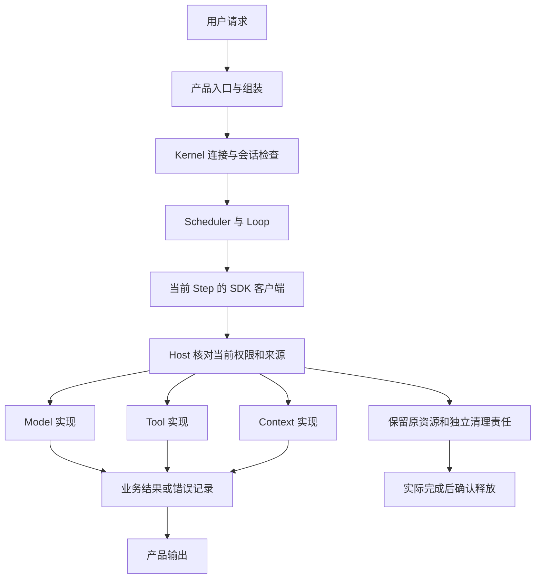

# 从一次请求理解 ifACE 与 Kernel 79

本文解释的是冻结源码如何分工，不是一份新的测试报告。Kernel 源码固定为第 79 个候选 `e3321bf5e10d39b014579da49e9b12ac58c8305d`。现有 `docs/iface-integration/iface-guide.md` 的主体固定在更早的 Kernel `0291` 与产品 `b871`；其中行号和当时结果仍是历史事实，不应直接当作 79 的源码定位。README 的历次账本发布数量也不能代替产品运行结果。

先记住三个不同的问题：**现在有没有权执行、这次业务返回了什么、它占用的资源是否真的释放。** Kernel 分别检查和记录它们。一个关闭请求已经收到，不代表后台任务结束；模型返回成功，也可能仍有连接或本地清理工作尚未结束。

## 一次请求经过哪些地方

下图说明接口责任和已实现的组件关系；产品整条入口仍在接线验证。产品入口收到用户请求后，由产品组装代码选择已安装的 Kernel 连接与能力实现。Kernel 先确认连接身份、会话、当前调用及允许使用的组件，再让调度器推进 Loop。Loop 决定接下来需要模型、工具还是上下文操作；具体效果通过 SDK 的资源客户端回到 Kernel，经过当前权限检查后，才交给实际产品实现。[A01][A02][A03]



| 部分 | 主要责任 | 不能据此推断的事情 |
|---|---|---|
| ifACE 能力合同 | 定义模型、工具等能力的输入、输出、错误和生命周期约定 | 有 trait 不等于已有产品实现 |
| Scheduler SDK | 为组件提供调用、Step 与资源协议 | SDK 方法名不授予权限，也不代替能力实现 |
| Kernel Core | 调度、原调用/Step 身份、持久记录、输入与子调用关系 | 不能凭产品正文宣称某个 OS 副作用已发生 |
| Kernel Host | 将已认证连接、当前租约、项目 owner、策略和实际能力连接起来 | 一次旧检查不能永久授权后续网络请求或工具执行 |
| PilotDeck | 原 Loop 算法、provider 转换、工具行为和用户可见结果 | 业务 ID、目录描述和回包不能自己生成 Kernel 执行许可 |
| 产品组装根 | 明确安装具体实现并选择正式入口 | 安装成功不等于所有入口、恢复与发行都已验收 |

## Step：当前这一步还能不能做事

会话可以活很久，一次 Loop 调用也可能经历多步。`Step` 表示其中当前正在执行的一步；`StepRef` 是查找它的引用，不是拿到字符串就能使用的通行证。

79 的 Host 保存原 `CallContext`、原连接入口和 Step 引用。使用时回到 Core 私有 Gate 检查这一步是否仍有效，并重新核对当前连接、主体、会话代次、调用状态、取消、期限及租约。资源方法本身也必须在原 binding 的允许集合里。[A04]

`scoped` 可以理解为“这次资源请求绑定当前这一步”。模型生成和工具任务会把这个来源继续传到实际执行检查，不能在前面通过一次检查后，把后续工作变成无来源的后台请求。

`inherited` 则是“真正的子调用沿用原父 Step 的边界”。这不是调用者填写父 ID 就成立：Context 子操作必须由 Core 的原 DispatchRecord 证明它确实是那个父调用派生的子调用，并保持原身份及操作关系。父 Step 结束或当前授权失效后，不允许靠旧引用发起新效果。[A05]

这不等于撤销能让所有已发生的外部效果倒退。对于已接纳的工作，79 保留原 future 的收尾关系；业务结果交付失败会保留 Unknown，而不是把已开始的工作改写为“从没执行”。原 `OUTCOME_UNKNOWN` 或 `JOURNAL_OUTCOME_UNKNOWN` 中的回执、原因也不能被一个泛化取消错误覆盖。[A05][A06]

## Tool PREPARE：先保住清理责任，再决定能否交付回执

工具批次的 PREPARE 会创建实际受管对象。这里有一个容易漏掉的窗口：对象已创建，但等待期间租约撤销了。若 Host 直接把成功回执改成拒绝，Core 就可能不知道应该清理哪个对象；若直接把成功回执交给业务，又可能越过已经失效的执行权。

79 将这两件事分开处理：[A06][A07]

1. 原 provider 真正返回成功的 PREPARE 回执后，Core 先登记原批次、provider、调用和 Step 的清理责任。错误返回不能凭空生成这份登记。
2. 完成 Core 的异步等待与检查后，再调用 Host 的同步 `finalize_tool_batch_prepare`。默认实现是 Unsupported，没有实现这道检查的 provider 不会悄悄获得许可。
3. Host 按回执中的批次引用找到真实对象，复核原 source、连接入口、租约、项目 owner 和 Step。最后检查与返回之间不再插入 await。
4. 若业务交付被拒绝，原清理责任仍保留。后续观察或关闭只能操作原已登记对象，不能把 STATUS/CLOSE 变成新 PREPARE 的授权入口。

这道最终检查**尚不是具体工具的最终参数审批**。PREPARE 时可能还没有最终参数和逐工具 permit。具体工具仍须在 `execute_final`、原准入和 worker 路径中完成自己的检查。回执里的 state/result/resources 是当时的观察，不能由调用者把它们改成 Released 就改变真实对象状态。

资源释放同样独立：Host 核对构造过程已经结束、父执行已经退出、批次 control 和所有 action 的真实释放情况后，才形成 Released 回执。单独 drop 一个消费 future、收到 CLOSE ACK 或停止请求，都不够。[A08]

## Model Router：同一个根请求，多个分别准入的尝试

Router 可能选第一家模型，也可能失败后尝试另一家。Kernel 79 的根 route 保存原受管请求、原输入快照和来源；每个 child attempt 绑定自己的完整模型候选与实际请求。不能把第一家获得的权限、凭据或预算直接借给第二家。[A09]

首个尝试可使用原生成任务已经准入的一次预付信用；后续尝试仍经过共同预算门，不能重复使用首个信用。实际 dispatch、发送请求和后续 pull 也须保持原来源有效。纯 `supports_binding` 形状检查、候选名称或 SDK 字段都不是执行许可。[A09][A10]

切换尝试还需要上一尝试的真实清理结果；“还未开始 HTTP”不等于完全没占用资源，因为准备阶段也可能已经持有资源。usage 的所有数量都未知时，只能记为未知观察，不能说已经完成精确计费，更不能凭空填零。完整原 Router 的选择、judge、fallback 与产品请求转换是否已经接通，要看对应产品代码与实际运行；Host 提供每尝试接缝本身不证明这些产品路径都完成。

## GatewayStart 与 History：记录来源和版本，不制造执行许可

输入准备也有前后两步：先在原 Scheduler 记录中预留输入身份，再将最终准备好的输入交给正常调度。预留本身不是已接纳的可执行调用。私有、一次性的 InputIntent 和可信组装根安装的 GatewayProducer 负责约束谁可以报告这次开始；恢复后看到记录，不会重新获得一次发送副作用的许可。[A11]

`GatewayStart` 是可信 Gateway 报告原 TurnRunner 已开始的一条事实。Core 将它关联到原预留输入、origin、Loop binding/context、producer 身份及事件摘要，通过同一 History CAS 写入。它不是 Kernel 亲眼观察了 OS 效果，也不是普通请求正文里写一个 started 字段就能获得的证明。[A12]

“固定 History 版本”（pin）应分清两层。Kernel 79 的 History prepare 核对 owner、事务摘要和 expected_revision；同事务重读返回原 reservation、`may_dispatch=false`，未决事务阻止后续新事务。这是在防止读到另一份历史后悄悄提交，或在回包丢失后重发效果。[A13] 产品在什么时候取得该历史快照、将它固定到哪个实际 turn、后续是否始终使用同一份，仍是产品接线责任。79 的这些字段和检查不能代替产品侧真实 pin 的来源证明。

## 版本号分别指什么

79 的公开能力接口包是 `agentcpm-iface 0.1.8`，Scheduler SDK 是 `agentcpm-scheduler-protocol 0.4.0`，宿主包是 `agentcpm-host 0.1.7`。这三项已分别核对冻结 Cargo.toml，不能把 Host 版本写成 ifACE 版本。组件包版本、协议名、连接协商 ABI 和具体 feature 支持是不同轴；安装同一个版本不代表它广告了所有可选能力。[A14]

## 已有证据可以说到哪里

本文只新增源码说明，没有执行新的测试。结果按受测身份分别列出，不拼成一份全绿组合：

| 证据身份 | 已知结果 | 解释边界 |
|---|---|---|
| Kernel 79 | 449 PASS、2 FAIL，并保留后台 RuntimeDrop panic；静态门通过 | 不能写成整个 79 通过。scoped cleanup/RuntimeDrop 与 inherited Context 断言失败仍待处理 |
| PD 41 | 四项静态检查，0 项 runtime | 证明对应静态检查，不证明实际入口执行 |
| 产品 `781672`／Kernel 75 | 65 PASS、1 ignore；当次严格 Clippy 两处失败 | Cron 只验证计划保存与工作区进入，fire 仍失败且保留 Git 错误；两处 lint 后由独立候选修复，不把各版本拼成联合全链通过 |
| 产品 `966`／Kernel 79 的 Tool P2 尝试 | helper 编译通过，Host 已就绪；完整 LocalGateway 的资格门返回 Unsupported，Tool target 为 NOT_REACHED | installed_scheduler 要求纯 snapshot 与 fullLate 两项能力，而 Host 79 不广告 fullLate；这次没有执行到工具，不能写成工具运行失败或 Gateway 已接通 |
| 后继 80 | 不纳入本文 79 的结论 | 未完整通过，修复候选不能反填 79 原失败 |

源码解释与运行事实分开保存。root 已实际读取并核对下列原始汇总的完整 SHA 和计数；这次核验没有重跑测试，也没有将后继修复回写为原版本通过：

- [Kernel 79：449 PASS／2 FAIL及后台诊断](../../_tmp/20261115-iface-linux/kernel-e3321bf5-summary.json)，SHA256 `5bd2b357052b405bcff4ea1e56dee2c038d745605b0086f0ba8757903a74f1db`。
- [PD 41／Kernel 76：四项静态检查、零运行](../../_tmp/20261115-iface-tests/pd-41c383-k76-static-closure-mac-summary-v1.json)，SHA256 `9b9874603e093d7f77fbb7511a3c403dffd8b20a980155453dd345b58dbacca5`。
- [PD 781／Kernel 75：65 PASS／1 ignore及两项lint首败](../../_tmp/20261115-iface-tests/pd-781672-k75-router-cron-mac-summary-v1.json)，SHA256 `94ce41fe77916078e3ce940ebeab369f00de7279619c985b4203061717e610b1`。
- [PD 966／Kernel 79：两次入口前置失败，Tool未到达](../../_tmp/20261115-iface-tests/pd-966788-k79-controlled-p2-first-mac-summary-v1.json)，SHA256 `d8b801c54d46be5fab83856a892a22c4498bc8d2b3e4adf4e4915c4a0ed06725`。

资格门的拒绝保留；后继受控 P2 测试入口与生产完整执行后端分别审阅。

真实 Host 加受控 Native 的 Tool fixture，即使后续通过，也只证明该受控 P2 路径；它不等于产品 NativeCodec、全部 hooks、完整取消/恢复、正式 CLI/Gateway 各入口与发行迁移都完成。这里不宣告 P2 或 P4–P7 关闭，也不宣布旧运行链已经退役。

## 如何复查源码

配套[源码锚清单](../../_tmp/20261116-iface-guide79/source-anchors.json) 给出每处 A 编号的完整提交、路径、准确行号、该行文本和文件 SHA；[冻结源码](../../_tmp/20261116-iface-guide79/source-anchors.md)是用 git show 导出的冻结源码副本。不要将这些行号直接套到后来的 live HEAD。

```sh
git -C <Kernel检出> show e3321bf5e10d39b014579da49e9b12ac58c8305d:kernel/host/src/transport/scheduler/step_authority.rs
```

建议阅读顺序是 A01 组装入口 → A04 当前执行权 → A06/A07 回执与清理 → A08 真实释放；再分别看 Model route 与 History。这样先了解一次调用的责任归属，再看协议和版本细节。

[A01]: /Users/da/.codex/worktrees/pilotdeck-iface-integration/pilotdeck-rs-cc2c/_tmp/20261116-iface-guide79/frozen-kernel79/kernel/host/src/startup/embed.rs:308
[A02]: /Users/da/.codex/worktrees/pilotdeck-iface-integration/pilotdeck-rs-cc2c/_tmp/20261116-iface-guide79/frozen-kernel79/kernel/scheduler-protocol/src/contract.rs:269
[A03]: /Users/da/.codex/worktrees/pilotdeck-iface-integration/pilotdeck-rs-cc2c/_tmp/20261116-iface-guide79/frozen-kernel79/kernel/host/src/transport/scheduler/resources.rs:250
[A04]: /Users/da/.codex/worktrees/pilotdeck-iface-integration/pilotdeck-rs-cc2c/_tmp/20261116-iface-guide79/frozen-kernel79/kernel/host/src/transport/scheduler/step_authority.rs:7
[A05]: /Users/da/.codex/worktrees/pilotdeck-iface-integration/pilotdeck-rs-cc2c/_tmp/20261116-iface-guide79/frozen-kernel79/kernel/core/src/scheduler/context_operations/step.rs:195
[A06]: /Users/da/.codex/worktrees/pilotdeck-iface-integration/pilotdeck-rs-cc2c/_tmp/20261116-iface-guide79/frozen-kernel79/kernel/core/src/scheduler/client.rs:460
[A07]: /Users/da/.codex/worktrees/pilotdeck-iface-integration/pilotdeck-rs-cc2c/_tmp/20261116-iface-guide79/frozen-kernel79/kernel/host/src/transport/scheduler/resources.rs:287
[A08]: /Users/da/.codex/worktrees/pilotdeck-iface-integration/pilotdeck-rs-cc2c/_tmp/20261116-iface-guide79/frozen-kernel79/kernel/host/src/startup/trusted_tool/batch.rs:127
[A09]: /Users/da/.codex/worktrees/pilotdeck-iface-integration/pilotdeck-rs-cc2c/_tmp/20261116-iface-guide79/frozen-kernel79/kernel/host/src/transport/model_session/execution/route.rs:71
[A10]: /Users/da/.codex/worktrees/pilotdeck-iface-integration/pilotdeck-rs-cc2c/_tmp/20261116-iface-guide79/frozen-kernel79/kernel/host/src/transport/model_session/execution/route/admission.rs:33
[A11]: /Users/da/.codex/worktrees/pilotdeck-iface-integration/pilotdeck-rs-cc2c/_tmp/20261116-iface-guide79/frozen-kernel79/kernel/core/src/scheduler/preflight.rs:1
[A12]: /Users/da/.codex/worktrees/pilotdeck-iface-integration/pilotdeck-rs-cc2c/_tmp/20261116-iface-guide79/frozen-kernel79/kernel/core/src/scheduler/history/gateway_start.rs:1
[A13]: /Users/da/.codex/worktrees/pilotdeck-iface-integration/pilotdeck-rs-cc2c/_tmp/20261116-iface-guide79/frozen-kernel79/kernel/core/src/scheduler/history.rs:108
[A14-iface]: /Users/da/.codex/worktrees/pilotdeck-iface-integration/pilotdeck-rs-cc2c/_tmp/20261116-iface-guide79/frozen-kernel79/kernel/iface/Cargo.toml:3
[A14-scheduler-protocol]: /Users/da/.codex/worktrees/pilotdeck-iface-integration/pilotdeck-rs-cc2c/_tmp/20261116-iface-guide79/frozen-kernel79/kernel/scheduler-protocol/Cargo.toml:4
[A14-host]: /Users/da/.codex/worktrees/pilotdeck-iface-integration/pilotdeck-rs-cc2c/_tmp/20261116-iface-guide79/frozen-kernel79/kernel/host/Cargo.toml:9
[A14]: /Users/da/.codex/worktrees/pilotdeck-iface-integration/pilotdeck-rs-cc2c/_tmp/20261116-iface-guide79/source-anchors.md
