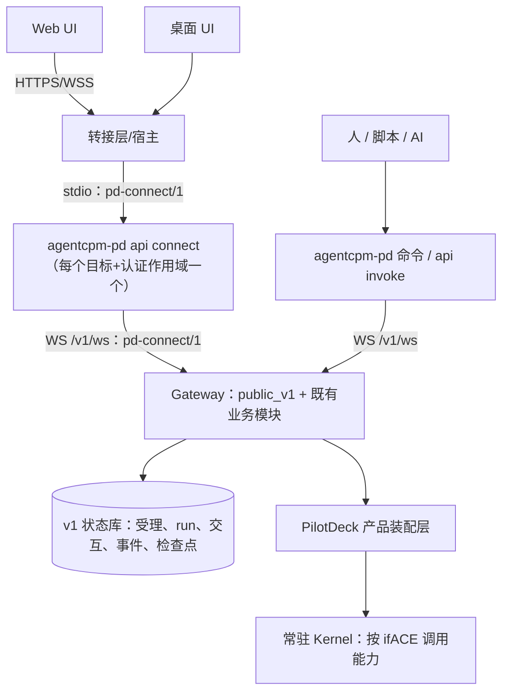

# agentcpm-pd CLI 方案（v0.7）

本文是 `agentcpm-pd` 新产品 CLI 的唯一可读方案。逐项机器合同见 `state/cli-v1-*.json`（§14）。用户已确认的决定、源码事实、本文的设计、尚待验证的部分分开写。

本版为 **v0.7**（在 v0.5/v0.6 独立评审基础上完成 5 路审校与工作区约束收口）：

- 响应和错误的形状与公共合同一致；
- 明确 CLI 到 Gateway 的 `pd-connect/1` 线协议、按 schema 声明条件注入 `instanceId`、`execution="local"` 边界及 6 个 `stream`（含 `terminals.output` S3 门禁）；
- `run` 后台持有采用 `submit_owned`，`run.snapshot` 在 S2 内联返回 `sections[].data`，`run.list`/`interaction.list` 默认 `scope={"kind":"instance"}`；
- 交互状态对齐 4 态合同并归 `public_v1` 持久持有；
- 基于 `unsafe_boundary.rs` 约束，在 `src/agentcpm-pd-protocol` 内用安全 Rust 实现 `{nodeId}-{uuidv7}`；
- 本轮精确 **28 个**操作（文件交接与终端推迟到 S3），工作包拆分为 `WP0-init` → `WP1a` → 并行 `WP1b/WP2/WP3/WP4` → `WP4-commit-gate` → `WP5` → `WP0-gate`。

**本文本身不是产品验收证据。**

---

## 1. 一页结论

- **产品**：`agentcpm-pd` 是新产品 CLI，有独立的数据目录和实例，不受旧 CLI、旧前端和 ui/server 约束；旧脚本通过可选的 `pilotdeck` 转换层（C1）调用它。
- **CLI 第一性**：所有业务都先能用 CLI 完成。UI 的业务请求真实经过一个长寿命的 `agentcpm-pd` 客户端进程，再到达 Gateway；不允许 UI 直连 Gateway 兜底。
- **进程模型**：每个"目标 + 认证作用域"保留一个主连接 `agentcpm-pd api connect`，承载请求、响应、交互、取消和事件。终端和大文件传输在 S3 用专用 CLI 进程和本地路径交接实现；**字节不走主连接的 stdio** 是现在就定下的原则。
- **协议**：宿主到 CLI、CLI 到 Gateway 两段都用 `pd-connect/1`：NDJSON + JSON-RPC 2.0，握手、错误码、ID、身份与 Kernel L-C 对齐。另外补上 Kernel 没有的四项：按订阅授予 credit、显式结束帧（`slow_consumer`/`gap`/`disconnected`）、请求级放弃、心跳与重连。业务载荷与公共合同的 envelope 一一对应。
- **Gateway**：新增 `/v1/ws` 入口和 `public_v1` 模块，用独立的 SQLite 实现持久受理、幂等、交互待办、按 run 的事件游标和快照。run 通过 `submit_owned` 由后台持有，断线不会取消。旧基线协议的路径不动。
- **分布式预留**：工作区写成 `(environmentId, path)`；ID 格式 `{node}-{uuidv7}`；身份来自传输层。首版不做远程执行环境。
- **本轮实施**：S1 公共基础，加上 S2 最小运行闭环，精确 **28 个**操作（§11.2，与 `operations.json` `currentRound` 一致）。

---

## 2. 已确认的决定

时间为北京时间。原话出自用户与 Codex 的会话 `01a1dab9…`，以及本会话。

| 编号 | 决定 | 确认时间与原话（摘要） |
|---|---|---|
| D1 | 目标是"所有功能都能用命令操作" | 11-14 23:43，问答选择 |
| D2 | 本地优先，兼容远程；首版只做本机和单用户远程，不做多人协作 | 11-14 23:44；11-15 22:10 选择"本机与单用户远程" |
| D3 | 全新设计，不受旧 CLI、旧前端、ui/server 约束 | 11-15 22:10："不用管旧的 cli，也不用管前端，不用管 ui/server" |
| D4 | 断线不取消，任务由后台持有；关闭客户端时可选择是否保留，启动时显示仍在运行的任务 | 11-15 22:05："应该是 1，然后客户端完全可以设计成关闭的时候选择是否保留后台任务继续运行，以及启动的时候显示还有哪些后台任务在跑" |
| D5 | 提交后默认返回编号，需要时再跟随 | 11-15 22:15 |
| D6 | 原 ui/server 的文件、Git、终端、凭据业务纳入后端 | 11-15 22:18 |
| D7 | 支持已有数据，必要时显式迁移 | 11-15 22:18 |
| D8 | 本机服务未运行时自动启动同一实例；CLI 退出后服务保留；远程连接失败不回落本机 | 11-15 22:23 |
| D9 | Gateway 崩溃后保留记录、显式续接，不自动重放 | 11-15 22:23 |
| D10 | 产品名为 `agentcpm-pd` | 11-15 23:38："新 cli 就叫 agentcpm-pd" |
| D11 | C1：可选的 `pilotdeck` 转换层；K1：通用知识查询 | 11-16 02:06："C1 很好，K1也很好。就这么办。" |
| D12 | UI 业务请求必须真实经过长寿命 CLI 客户端 | 11-16 04:17："就按真实 CLI 客户端必经的方案继续推进 S0" |
| D13（原 Q1） | 关闭桌面时询问，默认保留；启动时列出仍在运行的任务和待处理的交互 | 11-16 17:32："Q1–Q5 都按推荐" |
| D14（原 Q2） | 一个主连接加若干辅助进程；文件按本地路径交接；以原型指标冻结传输合同 | 同上 |
| D15（原 Q3） | 桌面内置同版本 CLI，可选链接到 PATH；握手时主版本不一致即拒绝 | 同上 |
| D16（原 Q4） | Web 远程：转接层和 CLI 跑在工作站上，浏览器直接访问 | 同上 |
| D17（原 Q5） | 新协议作为新增入口，与基线对齐主线共存，用对拍测试当护栏 | 同上 |
| D18（原 Q6） | 首版不做远程执行环境，只在合同中预留 `(environmentId, path)` | 11-16 17:39："Q6 按照你的推荐来" |

---

## 3. 术语

| 名称 | 职责 | 不负责 |
|---|---|---|
| CLI 人类命令入口 | `agentcpm-pd run submit …`：解析 argv，按 `--output` 渲染结果 | 执行模型循环；持有业务状态 |
| CLI 单次机器入口 | `agentcpm-pd api invoke <methodId> --input-json <file\|->`：stdout 输出一个合同 response | 解析人类日志 |
| CLI 长连接机器入口 | `agentcpm-pd api connect`：长寿命进程，跑 §6 的协议 | 成为第二个业务网关 |
| CLI 公共操作客户端 | 三个入口共用：注册表与 schema、目标解析、凭据、幂等键、Gateway 连接、错误归一化 | 替代服务端授权 |
| Gateway v1 | `/v1/ws`：认证连接，执行公共操作；唯一持有 run、队列、交互、事件 | 被 UI 直接访问 |
| 转接层（宿主） | 浏览器或桌面接入、认证映射、CLI 子进程监督、传输转换；为未决写入保存关联记录 | 实现业务；保存第二份业务状态；直连 Gateway |

`server serve/start/stop` 启动或停止 Gateway，`api connect` 连接 Gateway。即使由同一个二进制提供，它们也是不同的进程，生命周期也不同。

---

## 4. 调用拓扑与进程模型



- **主连接**：同一目标和认证作用域下，所有窗口共用一个 `api connect` 进程，宿主按请求 ID 和订阅 ID 路由。图中没有任何从 UI 或宿主直达 Gateway 的箭头。
- **S3 再补的辅助进程**：
  - 每个终端一个 `agentcpm-pd terminal attach --terminal-id <id> --machine`，命令路径和租约字段在 S3 补进命令树；
  - 文件通过本地路径交接，CLI 另开一条 Gateway 连接传输。
  - 在那之前，主连接不承载终端输出，也不承载文件字节。
- **桌面**：桌面内置同一构建的 `agentcpm-pd`，宿主只启动这一份（D15）。
- **Web 远程**：转接层和 CLI 跑在工作站上（D16）。
- **本机服务**：本机服务未运行时，CLI 用实例锁加就绪握手自动启动它（D8，§8）。远程连接失败直接报错，不回落本机。

---

## 5. 完整调用链：在已有会话中提交一次运行

以下为设计示例，不是实测结果。

**终端入口**

```sh
agentcpm-pd run submit --target local --session-id S1 \
  --input '[{"kind":"text","text":"检查 README 并说明用途"}]' --output json
```

argv 和 `api invoke` 入口里，如果调用方没有给幂等键，CLI 会在发送前生成一个，并持久保存到客户端状态目录。这个键会出现在输出和错误详情里，方便调用方事后查询受理结果。

**UI 入口**

1. 宿主在发送前持久保存 `{methodId:"run.submit", idempotencyKey:"intent-42", inputDigest}`。UI 的草稿保留到收到受理回执为止。
2. 宿主把请求写入主连接的 stdin：

```json
{"jsonrpc":"2.0","id":"r-17","method":"run.submit",
 "params":{"input":{"sessionId":"S1","input":[{"kind":"text","text":"检查 README 并说明用途"}]},
           "idempotencyKey":"intent-42"}}
```

3. CLI 校验方法名和 input schema；当操作在 input schema 中声明了 `instanceId` 属性时，从连接所绑定的目标**自动注入** `instanceId`（如果调用方显式传入且值不一致，在产生任何副作用之前就以 `INSTANCE_MISMATCH` 拒绝），其余操作（如只传 `runId` / `interactionId` / 全局 `instance.list` 等）不向 `params.input` 注入未声明字段，而是由连接上下文 `envelope.target.instanceId` 路由。`execution="local"` 的操作不经 `/v1/ws`（在 `api connect` 长连接内仅允许只读 `schema.list` / `schema.get`，本机生命周期类命令如 `service.*` 应在顶层独立执行，长连接内调用返回 `-32601` / `CAPABILITY_UNAVAILABLE`）。之后远程调用经 `/v1/ws` 转发给 Gateway；两个入口从这一步开始共用同一段客户端代码。
4. Gateway 依次校验主体、实例、会话归属、权限和幂等键：同一个键、同样的输入就回放原回执；同一个键、不同的输入就报冲突。然后按 `{node}-{uuidv7}` 分配 `runId`，在同一个 SQLite 事务里写入受理记录、run 和队列项，**提交成功后**才回复：

```json
{"jsonrpc":"2.0","id":"r-17","result":{"outcome":"accepted",
  "result":{"kind":"run","runId":"local-0193…","durable":true,"acceptedRevision":"rev-7","deduplicated":false,"state":"queued"}}}
```

5. 后台任务调用 `submit_owned`，传入这个 `runId` 来执行这次运行；事件按 run 写入持久游标。
6. UI 发起订阅：`sub.open {stream:"run.events", input:{runId}}`，然后按授予的 credit 接收事件。
7. 关闭窗口只会关闭订阅，run 继续执行。如果主连接崩溃，宿主重启 CLI，先调用 `requests.lookup {methodId:"run.submit", idempotencyKey:"intent-42"}` 确认结果，之后才放行同一意图的新写入。
8. 取消用 `run.cancel`，它同样需要先持久保存幂等键。取消被受理不等于 run 已经结束，以持久终态为准。

---

## 6. 长连接机器协议 `pd-connect/1`

这套协议同时用于宿主到 CLI（stdio）和 CLI 到 Gateway（`/v1/ws`，每个 WS 文本帧承载一条消息）。两段的差异集中在 §6.9。

### 6.1 分帧与进程纪律

- 编码为 UTF-8 NDJSON：一行一个 JSON-RPC 2.0 对象，以 `\n` 结尾，空行忽略。
- stdout 只输出协议帧；诊断信息走 stderr（`--log-format json` 时为结构化日志）。
- 单帧上限 1 MiB。超长的入站行在读取时截断丢弃，回复 `id:null` 的 -32600（`details.reason=frame_too_large`），然后继续读下一行。单条出站事件如果超过上限，以 `sub.end {terminal:"error"}` 结束该订阅，错误码为 `INPUT_TOO_LARGE`。

### 6.2 握手

第一条消息必须是 `initialize`，在此之前收到的任何请求都回复 -32002。

请求参数：

| 字段 | 说明 |
|---|---|
| `abi_version` | 本版为 1 |
| `api_version` | 期望的操作合同版本，semver |
| `features[]` | 本版定义 `subscriptions`、`credit`、`heartbeat`；双方取交集，未知项忽略 |
| `client{name,version}` | 客户端信息 |
| `credential` | 仅 `/v1/ws` 一段使用，见 §6.9 |

响应字段：`abi_version`、`supported`、`api_version`、`supported_features`、`connectionId`，以及以下三组：

| 字段 | 内容 |
|---|---|
| `cli` | 仅 stdio 段：`version`、`build`（git 提交加内容 hash）、`pid`、`executable` |
| `target` | `name`、`instanceId`、`nodeId`、`gatewayVersion`、`schemaDigest`、`transport{kind, attested}` |
| `limits` | 见 §6.10 |

- 版本不支持时回复 -32006，`data.supported` 列出可用版本（Kernel 约定）。
- `cli` 和 `target` 两组字段是验收项 A2 的证据来源。
- 启动参数为 `agentcpm-pd api connect --target <name> [--log-format json]`。凭据从目标配置里的凭据引用读取，不经过 argv。

### 6.3 业务调用：与合同 envelope 的映射

| 公共合同 envelope | `pd-connect/1` |
|---|---|
| `version: "agentcpm-pd.operation/1"` | 握手时协商的 `api_version`，单条消息不再携带 |
| `requestId` | JSON-RPC `id`：字符串，最长 256 字符（对齐公共合同 `$defs.id` 的 `maxLength: 256`），在未完成请求中唯一，重复时回复 -32600 |
| `methodId` | JSON-RPC `method` |
| `target` | 由连接绑定；CLI 填入 `target.instanceId`；仅当该操作的 input schema 声明了 `instanceId` 属性时自动注入 `params.input.instanceId`（未声明时不注入额外字段） |
| `params` | `params.input` |
| `idempotencyKey`、`expectedRevision` | `params.idempotencyKey`、`params.expectedRevision` |
| response `outcome: succeeded / accepted` | JSON-RPC `result = {outcome, result}`；accepted 时 `result` 就是 receipt 本身，不再嵌套 |
| response `outcome: failed` | JSON-RPC `error = {code:-32000, message, data:<合同 error 对象>}`；`data` 即 `{code, message, details, retry:{mode, afterMs}, effect: not_applied\|unknown\|applied}`；Kernel 风格的 `reason/domain` 放进 `details` |

- A6（argv 与机器入口等价）的判定方法：把机器入口的输出按上表还原成合同 response，再与 argv 入口的结果比较。
- CLI 校验规则：
  - 方法不在内置注册表中，回复 -32601；
  - input 不符合 schema，回复 -32602，并在 `data.details.path` 中指出位置；
  - 重试类别为 `idempotentSubmit` 的操作缺少幂等键，回复 -32086。在 `api connect` 上，幂等键必须由调用方提供并自行持久保存，CLI 不代为生成；argv 和 `api invoke` 两个入口由 CLI 生成并保存。
- **控制类操作**：注册表新增 `priority` 字段。下列 11 个操作为 `control`：`run.cancel`、`operations.cancel`、`interaction.respond`、`approval.respond`、`requests.lookup`、`run.snapshot`、`operations.snapshot`、`run.get`、`operations.get`、`interaction.get`、`interaction.list`。它们在 CLI 和 Gateway 两侧都有独立的配额和发送队列。
- **超时**按操作区分：
  - 一般操作 30 s；
  - 输入里带 `timeoutMs` 的操作（如 `run.wait`），超时取 `timeoutMs + 5 s`；
  - 订阅不设超时。
  - 写操作超时后返回 `RESULT_UNKNOWN`，`effect: unknown`，并回显幂等键。

### 6.4 订阅、事件与背压

- **打开订阅**：`sub.open {stream, input, credit?}`，返回 `{subscriptionId}`。
  - `stream` 只能是合同中执行类型为 `stream` 的 6 个操作：`run.events`、`operations.events`、`terminals.output`、`resources.watch`、`host.stream_model`、`notifications.events`。这 6 个操作都在 input schema 中声明 `follow`（其中 S3 操作 `terminals.output` 与 `resources.watch` 暂保留各自游标字段映射，其余 4 个统一用 `afterCursor`）；`terminals.output` 在 S3 之前（无论走 `sub.open` 还是 `follow=false` 一元调用）统一返回 `-32004` / `CAPABILITY_UNAVAILABLE`。
  - `input` 按该操作的 schema 填写；CLI 强制 `follow=true`，并拒绝 `page`。
  - 起点由 `input.afterCursor`（或对应操作的游标字段）决定；缺省表示从保留日志的最早位置开始。
  - 同一个操作以 `follow=false` 作为一元调用时，返回一页数据。
- **事件帧**：`sub.event {subscriptionId, event}`，`event` 即合同中的 `agentcpm-pd.event/1` 对象，其中 `cursor` 是 Gateway 持久化的不透明游标。
- **结束帧**：`sub.end {subscriptionId, terminal, resumeCursor, gap?, error?}`。`terminal` 的取值：

| terminal | 含义 |
|---|---|
| `completed` | 资源已到终态，事件全部送达 |
| `closed` | 调用方主动关闭 |
| `slow_consumer` | 缓冲溢出 |
| `gap` | 游标已失效，附带合同中的 `$defs.gap` 对象 |
| `disconnected` | 上游连接断开 |
| `shutdown` | 进程正在退出 |
| `error` | 其他错误 |

  这套取值参照了 Kernel 的 closed、error、slow_consumer、shutdown，另加 completed、gap、disconnected，不使用 blocked 和 export_done。
- **游标失效**：打开订阅时游标就已失效，回复 -32000，`code=CURSOR_EXPIRED`，`details.gap` 携带 `$defs.gap` 对象。订阅进行中失效，则以 `sub.end gap` 结束并携带同一对象。标准恢复流程是：`run.snapshot`（S2 内直接于 `sections[]` 返回每节 ≤ 256 KiB 的内联结构化 `data`）→ 取 `snapshot.checkpoint.cursor` → 以它作为 `afterCursor` 再次 `sub.open`。
- **流控**：
  - 调用方用 `sub.credit {subscriptionId, add}` 授予额度，发送方不会超出剩余额度发送。
  - 每个订阅的缓冲上限为 1024 条或 4 MiB。溢出时清空缓冲，以 `sub.end slow_consumer` 结束，`resumeCursor` 设为最后一条已送达事件的游标。
  - 事件已在 Gateway 持久化，所以清空缓冲不会丢数据，调用方从 `resumeCursor` 重新订阅即可。
  - 这套规则在 Gateway 到 CLI、CLI 到宿主两段都适用。
- **优先级**：写出端维护两个队列。控制队列（响应、`sub.end`、`conn.*`）优先于事件队列（`sub.event`）。事件缓冲满了不会阻塞对上游的读取。
- **心跳**：空闲时每 `heartbeatMs`（默认 5 s）发一次 `conn.heartbeat`。宿主连续 3 次没收到，就判定 CLI 卡死，杀掉并重启。

### 6.5 两种取消

- **业务取消**：`run.cancel`、`operations.cancel`，属于控制类操作，需要幂等键。
- **请求级放弃**：`conn.abandon {id}`，只在 stdio 段提供。CLI 不再等待该请求，对原 `id` 回复 -32800。各类请求的 `effect`：
  - 读请求：`not_applied`；
  - 尚未发出的写请求：`not_applied`；
  - 已经发出的写请求：`unknown`，并附幂等键。
  - **放弃不会取消任何业务。**

### 6.6 断线、崩溃与恢复

- **stdin EOF 或 SIGTERM**：停止接收新请求，最多等 5 s 让在途请求返回，以 `shutdown` 结束所有订阅，然后退出，退出码 0。收到 **SIGINT** 时流程相同，退出码 130。**任何情况下都不会自动发出 `run.cancel`**（D4）。
- **与 Gateway 断开**：
  1. 发出 `conn.state {state:"reconnecting", attempt}`。
  2. 在途请求：读请求回复 `CONNECTION_FAILED`（`effect: not_applied`），写请求回复 `RESULT_UNKNOWN`（`effect: unknown`）。
  3. 所有订阅以 `disconnected` 结束，附带 `resumeCursor`。
  4. 按 0.5 s 到 10 s 的退避加抖动重连。重连期间的新请求直接回复 `CONNECTION_FAILED`，不排队。
  5. 重连成功后发出 `conn.state ready`。如果 `instanceId` 变了，改发 `conn.state failed`（`details.reason=instance_changed`）并拒绝继续。
- **CLI 崩溃**：
  1. 宿主通过进程退出、EOF 或心跳缺失发现崩溃，把所有未决写入标为"结果未知"。
  2. 按退避重启 CLI；一分钟内超过 5 次就显示离线。
  3. 重新握手后，用已保存的 `{methodId, idempotencyKey}` 逐条调用 `requests.lookup`，确认完毕才放行同一意图的写入。
  4. 宿主只保存这类关联记录，不保存业务状态。
- **Gateway 崩溃**：机制见 §7.5（D9）。

### 6.7 大对象与终端（S3）

- **原则**：主连接 stdio 不内嵌文件字节；文本类业务字段按 schema 内联，上限 256 KiB。
- **S3 实现**：
  - 文件：本地交接方法 `local.upload_file`、`local.download_artifact`，路径限制在宿主声明的根目录内，由 CLI 用 `uploads.*`、`artifacts.read` 完成传输；
  - 终端：专用进程，帧包括 `term.output`、`term.input`、`term.resize`、`term.exit`，携带 `serverEpoch`、`controlEpoch`、`leaseToken` 引用和 `inputSeq`。
  - 两者都在 S3 合同冻结前定稿，届时测 P1 和 P2。

### 6.8 错误码与退出码

| 码 | 含义 |
|---|---|
| -32700 / -32600 / -32601 / -32602 | 解析失败 / 非法请求（含帧超长、重复 ID）/ 未知方法 / 参数不符合 schema |
| -32002 | 未初始化（Kernel） |
| -32006 | 版本不支持（Kernel） |
| -32086 | 缺少幂等键（Kernel） |
| -32800 | 请求被放弃 |
| -32000 | 应用错误，`data` 为合同 error 对象，`data.code` 取自公共错误登记表 |

- 致命错误：先在 stdout 发出 `conn.fatal {code, message}`，同时写 stderr，然后退出。
- 退出码：
  - `api invoke` 和其他命令沿用合同：0 成功，1 已知失败，2 用法错误，3 写结果未知，130 观察被中断；
  - `api connect`：0 正常，1 运行期致命错误，2 用法或配置错误，130 收到 SIGINT。

### 6.9 两段的差异

| 项目 | 宿主 ↔ CLI（stdio） | CLI ↔ Gateway（`/v1/ws`） |
|---|---|---|
| 认证 | 子进程管道，信任等同于 Kernel 的 `local-child` | `initialize.credential` 携带连接凭据；主体只在连接时认证一次，之后的消息不能自报身份（D67） |
| `conn.abandon` | 有 | 无 |
| `cli` 握手字段 | 有 | 无 |
| 控制类配额、订阅缓冲、`slow_consumer` | 有 | 有，由 Gateway 执行 |
| `conn.state` | 由 CLI 发出 | 无，表现为 WS 断开 |

### 6.10 默认上限

单帧 1 MiB；普通请求 64 个并发，控制类 16 个；订阅数 64；默认 credit 256；单个订阅缓冲 1024 条或 4 MiB；心跳 5 s；一元调用 30 s（带 `timeoutMs` 的操作除外）；EOF 后等待 5 s。握手时不能修改这些值。

### 6.11 复用与差异

| 来源 | 直接复用 | 改写或新增 |
|---|---|---|
| Kernel L-C | NDJSON 加 JSON-RPC；`initialize` 字段集、-32006、-32002、-32086；-32000 加结构化 data；不透明游标；`{nodeId}-{uuidv7}` 与 `IdGenerator(nodeId)` 规范；身份来自传输层 | credit；显式结束帧；请求级放弃；连接心跳；与合同 envelope 的映射；工作区内纯安全 Rust 实现（不跨出 `src/` 依赖外部 path） |
| GPUI `pilotdeck-control connect` | 有界读写；ID 校验与未决请求上限；token 脱敏；"结果未知不重放"；宿主黑盒测试思路 | 强制握手；读、写、上游三个任务分开并区分控制优先级；统一错误码；EOF 不取消；重连与重启；订阅从宿主轮询改为 CLI 内推送 |

---

## 7. Gateway v1（D17）

### 7.1 挂载

`serve_socket` 在 WS 升级之后按路径分叉：`/ws` 继续走原来的 `transport_with_budget`，`/v1/ws` 交给 `public_v1`。为此提供单独的 v1 builder / 入口传入 `Arc<PublicV1State>`，而原有无 v1 状态的旧调用链与 `/ws` 行为保持不变。

允许修改的现有文件（严格白名单）：

- `native_ws.rs`：升级后按路径分叉（`/ws` vs `/v1/ws`），以及新增接纳 `PublicV1State` 的 builder / `serve_socket` 入口；
- `runtime/turn/gateway.rs`（必要时）：仅开放或复用 `owned` 提交与回调接入（不修改 `methods/mod.rs` 和 `native_process/assembly.rs`）；
- `lib.rs`：导出 `public_v1` 模块；
- `pilotdeck-gateway/Cargo.toml`：仅新增工作区内路径依赖 `agentcpm-pd-protocol = { path = "../agentcpm-pd-protocol" }`（**禁止**直接添加指向 `../deps/agent-kernel/...` 的工作区外本地 path 依赖，避免触发 `unsafe_boundary.rs` 门禁失败）。

闸门：native-ws 相关的对拍和变异测试、`unsafe_boundary` 全部门禁必须保持通过。v1 方法不进 `methods/mod.rs` 与 `register_families` 表。

### 7.2 执行

- 用 `TurnSubmitter::submit_owned` 提交，显式传入 v1 分配的 `runId`（`input.runId`）。run 的生命周期与连接无关。
- 若无真实模型密钥或测试态未配置上游 provider，持久化受理、状态机、`run.cancel`、`queue.resume`、`interaction.*` 等均不依赖外网模型也可完整闭环（由测试 adapter 或可控 turn runner 驱动事件/权限回调）。
- 会话内串行执行、出错后暂停的语义由 `public_v1` 维护。

### 7.3 存储与一致性

- 存储位置：`<home>/v1/state.sqlite`（使用已在 `Cargo.lock` 锁定的 `rusqlite` `0.39.0` bundled）。
- 表：受理记录（作用域、methodId、幂等键、输入摘要、回执）、project、session、run、队列状态、交互待办、按 run 的事件和游标、检查点。
- `run.snapshot` 的 `sections[]` 在 S2 阶段直接内联返回结构化 `data`（每节上限 256 KiB，覆盖 `state` / `history` / `interactions`）；可选 `artifactId` 字段保留作 S3 超大截面落盘扩展。
- 现有提交路径仍会写 `runs/registry.json`。对 v1 来说，**SQLite 是唯一权威**，registry.json 只是旧路径留下的副本。v1 只读 SQLite；两边不一致时以 SQLite 为准，并记录诊断。

### 7.4 交互

- 审批和提问来自 run 的权限回调，由 `public_v1` 持久化为交互待办，绑定到主体和 run，不绑定连接。
- 现有基于连接的审批状态（连接断开即清空）不用于 v1。
- `interaction.list/get/respond` 和 `approval.respond` 读写这份待办，状态枚举与 `public-contract.json#$defs.interaction` 严格一致（`pending` / `answered` / `expired` / `cancelled`，`kind` 为 `approval` / `question`）。

### 7.5 Gateway 崩溃恢复

启动时扫描 v1 存储：

- `running` 或 `cancelling` 的 run 改为 `interrupted`；无法确定是否已产生外部副作用的，改为 `result_unknown`；
- `queued` 的 run 保持不变，但该会话的队列以 `pauseReason=gateway_restart` 暂停，只有显式调用 `queue.resume` 才继续；
- 待处理的交互改为 `expired`。
- **不自动重放任何操作。**

### 7.6 ID、数据目录与旧路径

- ID 由 `agentcpm-pd-protocol` 内的 `IdGenerator(nodeId)` 生成（基于已在工作区锁定的 `uuid = "=1.27.0"` 生成 `{nodeId}-{uuidv7}`），格式与 Kernel `L-C` 对齐，零 `unsafe` 且满足 `unsafe_boundary.rs`。
- 数据目录为 `AGENTCPM_PD_HOME`，见 §8。
- 旧路径：本轮不改。D17 中"旧 submit 改为调用新内核的适配器"推迟到基线对齐主线结项之后。

---

## 8. 实例、凭据与本机自动启动

- **数据目录**：`AGENTCPM_PD_HOME`，默认 `~/.agentcpm-pd`，权限 0700，与 `~/.pilotdeck` 分开。Gateway 的会话、配置等模块在 v1 实例中也使用这个目录。测试一律使用临时目录。
- **初始化**（`instance.initialize` 无需预先绑定 `target`，可直接本地创建或初始化实例目录）：
  - `dataRoot` 省略时默认取 `AGENTCPM_PD_HOME`（未设置时默认 `~/.agentcpm-pd`）；
  - `nodeId` 省略时默认 `"local"`，满足 `[a-z0-9-]{1,64}`；`instanceId` 省略时由 `IdGenerator(nodeId)` 生成 `{nodeId}-{uuidv7}`；
  - 生成 `instance.json`：`{instanceId, nodeId}`，权限 0600，结果 `identity` 包含 `instanceId` 与 `nodeId`；
  - 生成 `credentials/local.token`：权限 0600；
  - 客户端配置中的 `local` 目标：loopback 地址加凭据文件引用。
- **服务管理**（`service.start` / `service.status` / `service.stop`）：
  - `dataRoot` 可省略，默认按 `AGENTCPM_PD_HOME` / `~/.agentcpm-pd` 推导，并从 `<dataRoot>/instance.json` 读取 `expectedInstanceId` 核对身份；在 `api connect` 长连接中禁调本机服务控制（仅顶层 CLI 可用）。
- **自动启动**（D8）：
  1. 客户端库发现本机目标连不上；
  2. 取得实例锁，以后台方式执行 `agentcpm-pd server start`（对应操作 `service.start`）；
  3. 等待 Gateway 在 `<home>/run/ready.json` 写出 `{pid, address, instanceId, build}`；
  4. 核对 `instanceId` 后再连接。
  - 多个 CLI 同时触发时，只会启动一个 Gateway。
- **职责划分**：Gateway 侧的初始化、就绪文件、`service.{start,status,stop}` / 前台 `server serve` 库函数归 WP4d；客户端侧的自动启动、默认 `dataRoot` 推导与目标配置归 WP2；`server {serve,start,status,stop}` 与 `instance init` 的 CLI 子命令外壳及参数绑定在 WP3 的 crate 里，只调用 WP4d / WP2 提供的库函数（不存在单独的顶层 `service` CLI 子命令）。

---

## 9. 与 Kernel / ifACE 的边界

- CLI 面向产品操作，ifACE 面向运行能力。一条命令可以用到多个能力组件，一个组件也可以支撑多条命令。
- 可复用的能力实现通过 ifACE 接入，不反向依赖 PilotDeck 产品层。产品转换留在装配层。
- 解耦完成的证据：在不加载 PilotDeck 产品层的合规宿主中跑通合同场景。
- 三项分布式预留：
  1. `workspace: {environmentId, path}`，首版只接受 `local`（D18）；
  2. ID 格式 `{node}-{uuidv7}`；
  3. 身份来自传输层。
- 本期不依赖 Kernel 的跨设备组网。CLI 到 Gateway 的传输可替换。

---

## 10. 验收

### 10.1 架构验收

| 编号 | 验证内容 | 通过要求 |
|---|---|---|
| A1 | 仅用 CLI 完成提交、观察、交互、取消和结果查询 | 不启动 UI 或宿主 |
| A2 | 链路归属 | 宿主连接、CLI stdin、CLI 发往 Gateway 的请求三者可以关联；记录 CLI 的 pid、build 和目标身份 |
| A3 | 受控阻断 | 在请求尚未转发处终止 CLI，并暂停自动重建：UI 显示不可用，Gateway 没有收到这次提交，也没有旁路请求 |
| A4 | 自动重建 | 新进程身份有记录；未知写入先按 methodId 加幂等键查询 |
| A5 | 观察者与 run 脱钩 | 受理后终止 CLI，run 继续运行；另一个 CLI 可以恢复查询 |
| A6 | 双入口等价 | 按 §6.3 的映射还原后，argv 与结构化入口的结果一致 |
| A7 | 宿主无业务旁路 | 依赖和网络审计中，宿主没有直连 Gateway 的业务客户端 |
| A8 | 流与背压 | 慢消费者、超限、并发交互都有上界；背压不阻断控制类操作（终端和附件部分在 S3 验收） |
| A9 | 新功能准入 | 先有公开操作、CLI 路径和 CLI 验收 |

### 10.2 传输一致性（T1–T11；"模拟"表示用模拟 Gateway 验证 CLI 侧）

| 编号 | 场景 | 阶段 |
|---|---|---|
| T1 | 未握手回复 -32002；版本不支持回复 -32006 并带 `supported` | S1 |
| T2 | 重复 ID 回复 -32600；超长帧丢弃后连接仍可用 | S1 |
| T3 | 未知方法 -32601；schema 不符 -32602 并带 path；`api connect` 缺幂等键 -32086 | S1 |
| T4 | 自动注入 `instanceId`；不一致时在副作用之前以 `INSTANCE_MISMATCH` 拒绝 | S1 模拟 / S2 真实 |
| T5 | credit 用完即停止发送，补充后从断点继续 | S1 模拟 / S2 真实 |
| T6 | 不读取 stdout 时以 `slow_consumer` 结束；按 `resumeCursor` 续订后事件不重复、不缺失 | S2 |
| T7 | 事件缓冲塞满时，`run.cancel` 和 `interaction.respond` 的延迟仍在上限内 | S2 |
| T8 | stdin EOF 后 run 继续运行，退出码 0，订阅以 `shutdown` 结束 | S1 模拟 / S2 真实 |
| T9 | Gateway 重启：在途写请求回复 `RESULT_UNKNOWN`，订阅以 `disconnected` 结束，续订无缺失；中断的 run 标为 `interrupted`，队列暂停 | S2 |
| T10 | `instanceId` 变化时发出 `conn.state failed`，不静默切换 | S2 |
| T11 | `conn.abandon` 不取消业务；未发出的写请求 `effect` 为 `not_applied` | S1 |

### 10.3 原型门槛

| 编号 | 指标 | 门槛 | 时机 |
|---|---|---|---|
| P1 | 本机终端回显 | p95 < 30 ms | S3 冻结终端合同之前 |
| P2 | 上传 500 MB 期间的审批应答 | p95 < 200 ms | S3 冻结文件交接合同之前；本轮先用"事件洪泛期间的控制类操作延迟"（T7）近似测量 |
| P3 | 主连接被杀到重新就绪 | < 2 s | 本轮 |

---

## 11. 分期与本轮实施

### 11.1 分期

| 阶段 | 内容 | 完成要求 |
|---|---|---|
| S0 | 本方案、合同 JSON、四表同步 | 静态检查和独立复核通过 |
| S1 | 协议、客户端、CLI 三个入口、Gateway v1 握手与能力发现、实例初始化与自动启动 | T1–T3、T11 真实通过；T4、T5、T8 用模拟 Gateway 通过 |
| S2（本轮先做最小闭环） | §11.2 列出的操作；持久受理；交互；事件；恢复 | 与 `state/cli-v1-roadmap.json` S2 `completionGate` 一致：A1–A8、T1–T11 真实端到端通过、P3 < 2s |
| S3 | 其余业务域，以及终端、文件交接 | 逐域合同与故障验收；P1、P2 |
| S4 | C1、迁移、发行（含桌面内置 CLI） | 兼容矩阵；迁移可验证 |
| S5 | 联合验收 | macOS/Linux、本机/远程 |

### 11.2 本轮操作范围（精确 28 个）

| 类别 | 操作 |
|---|---|
| 系统 | `system.capabilities`、`system.health`、`schema.list`、`schema.get` |
| 实例 | `instance.initialize`、`service.start/status/stop` |
| 项目与会话 | `project.register/get/list`、`session.create/get/list` |
| 运行 | `run.submit/get/list/events/snapshot/cancel/wait`、`requests.lookup` |
| 队列 | `queue.get/resume` |
| 交互 | `interaction.list/get/respond`、`approval.respond` |

合同调整（归 WP1b，0.7 已落地到合同 JSON）：

- `run.list` 与 `interaction.list` 的 `scope` 设默认值 `{"kind": "instance"}`，因此 `agentcpm-pd run list --states queued,running,waiting,cancelling`（D4/D13）和 `agentcpm-pd interaction list` 可直接无 `--scope` 执行；
- `run.list` 的单个 `state` 参数扩展为 `states[]`，用于 D13 的"仍在运行"列表；
- 仅当操作的 input schema 声明 `instanceId` 属性时，CLI 从 `envelope.target.instanceId` 自动注入 `instanceId`；
- 注册表新增 `priority` 与 `errors` 字段。

### 11.3 工作包

代码位置：worktree `/Users/da/ws/pilotdeck-rs-agentcpm-pd`，分支 `codex/agentcpm-pd-cli-20261116`，基于 `codex/iface-integration-20261115@b42bfdd97`。每个工作包有自己的分支，由集成者合并。

| 工作包 | 内容 | 依赖 |
|---|---|---|
| WP0-init 骨架 | 建 worktree 和三个新 crate 骨架；**独占** `src/Cargo.toml` 与 `Cargo.lock` | — |
| WP1a 帧与类型 | `agentcpm-pd-protocol`：JSON-RPC 帧、`pd-connect/1` 全部消息类型、envelope 映射、错误码与合同 error 对象、`{nodeId}-{uuidv7}` typed-id。**最先冻结** | WP0-init |
| WP1b 注册表与校验 | 从 `cli-v1-operations.json` 生成内置注册表（含 `priority` 与 `errors`），实现 JSON Schema 子集校验器，用 285 个操作的正反样例检查 | WP1a |
| WP2 客户端 | `agentcpm-pd-client`：目标与凭据、`/v1/ws` 客户端、重连、订阅与游标、argv/invoke 入口的幂等键持久化、本机自动启动与默认 `dataRoot` | WP1a |
| WP3 CLI | `agentcpm-pd-cli`（bin `agentcpm-pd`）：由命令树生成 argv 解析；`api invoke`；`api connect`（三个任务、控制优先级、credit、心跳、EOF 和信号处理）；`schema`；`server` / `service` 子命令外壳（开发期可用模拟客户端，集成前接入 WP2/WP4d） | WP1a、WP1b |
| WP4a 路由与握手 | `/v1/ws` 分叉、`initialize` 与凭据认证、方法分发骨架、`system.*`、`schema.*`、`terminals.output` 等未到阶段返回 `CAPABILITY_UNAVAILABLE` | WP1a、WP1b |
| WP4d 生命周期 | 实例初始化、凭据、就绪文件、`server serve` / `service {start,status,stop}` 的库函数 | WP4a |
| WP4b 存储 | SQLite 结构、受理与幂等、`requests.lookup` | WP4a |
| WP4c 运行托管 | `submit_owned` 接入、事件投影与游标、快照（内联 `sections[].data` ≤ 256 KiB）、取消、交互待办（aligned `Interaction` 枚举）、会话队列与暂停、崩溃恢复、项目与会话最小集 | WP4a、WP4b、WP4d |
| WP4-commit-gate 提交门槛收口 | §7.1 闸门升格验证（gateway lib+tests 全量、native-ws 对拍与变异、unsafe_boundary、clippy --all-targets）、缺口（gap）断言与回归测试补齐后单提交合入 | WP4a、WP4b、WP4c、WP4d |
| 治理登记 | 007 修订（§7.1 白名单与计数口径）、计划索引落档、交接归档与进度入口挂链 | 两项裁决结论（2026-11-17 已毕业 D19/D20） |
| WP5 验收 | 模拟 Gateway、T1–T11、A1–A8 关键场景端到端测试、P3 测量与对照负例 | WP1b、WP2、WP3、WP4-commit-gate（测试骨架可并行编写，端到端全量依赖各包完成） |
| WP0-gate 集成门禁 | 各工作包合并回 `codex/agentcpm-pd-cli-20261116`；`cb8`（Linux）与 `mbp2`/本机（macOS）四条命令全量验证；回写状态与多维表格 | WP5 |

- **关键路径**：WP0-init → WP1a → WP4a → WP4b → WP4c → WP4-commit-gate → WP5 → WP0-gate。WP1a 必须尽快冻结。
- **冲突热点**：
  - `src/Cargo.toml` 和 `src/Cargo.lock` 归 WP0-init / WP0-gate；
  - `native_ws.rs`、`lib.rs`、`pilotdeck-gateway/Cargo.toml`（只增 `agentcpm-pd-protocol`）归 WP4a；
  - `runtime/turn/gateway.rs`（必要时开放 `owned` 接入）归 WP4c；
  - `native_process/assembly.rs`、`methods/mod.rs`、`pilotdeck-cli` **严格不修改**。
- **新依赖**：尽量不加；确需新增时版本精确钉住，并说明理由；不下载预编译二进制；工作区内不得引入指向 `src/` 外的本地 `path` 依赖（满足 `unsafe_boundary.rs`）。
- **构建分工**：不依赖 Gateway 的 crate 在本机构建；Gateway、跨平台集成与端到端测试在 `cb8`（`/home/clawbox-08/ws/pilotdeck-rs-cc2c/`，`CARGO_BUILD_JOBS=6`，源码按 `git bundle` 传送，Kernel 固定为 `fb54c74a`）及 `mbp2`/本机 macOS（若 `mbp2` 不可达则用本机 macOS）并行编译测试。
- **里程碑**：四条命令全量检查。没过就如实记录。

---

## 12. 用户可感知的体验要求

| 场景 | 要求 |
|---|---|
| 关闭桌面时仍有任务在运行或等待审批（D13） | 弹窗："保留后台运行"（默认）/"全部取消并停止服务" |
| 启动桌面或执行 `run list --states queued,running,waiting,cancelling`（D4） | 先列出仍在运行的任务和待处理的交互 |
| 终端里的 CLI 与桌面内置版本不同（D15） | 桌面只使用内置的 CLI；主版本不一致时明确提示 |
| 有大量事件时进行审批或取消（D14） | 走控制队列，不被事件拖慢 |
| 浏览器远程访问工作站（D16） | 笔记本上只需要浏览器 |

---

## 13. 风险

| 风险 | 处理 |
|---|---|
| Gateway 编译慢（约 60 万行） | 新 crate 不依赖它；Gateway 测试集中在 cb8 跑 |
| 没有现成的 JSON Schema 校验库 | 实现子集（type、required、enum、const、oneOf/anyOf、not、$ref/$defs、additionalProperties、长度、数值范围、pattern），并用 285 个操作的样例检查 |
| `submit_owned` 和 TurnGateway 的内部假设 | WP4c 先写特征测试；保留对拍闸门 |
| registry.json 与 SQLite 双写 | 以 SQLite 为准；定期对账并记录诊断 |
| `unsafe_boundary.rs` 禁止跨出 `src/` 的本地路径依赖 | 在 `src/agentcpm-pd-protocol` 中用锁定 `uuid = "=1.27.0"` 实现 `{nodeId}-{uuidv7}`；Kernel 外部工作树仅作对拍参照不作 Cargo path 依赖 |
| 原型指标不达标 | 回到 D14 重新评估，不冻结传输合同 |

---

## 14. 设计文件与修订记录

- 本文：可读方案正本。
- 机器合同：[公共合同](../../state/cli-v1-public-contract.json)、[操作目录](../../state/cli-v1-operations.json)、[命令树](../../state/cli-v1-command-tree.json)、[决定](../../state/cli-v1-decisions.json)、[来源审计](../../state/cli-v1-source-audit.json)、[分期](../../state/cli-v1-roadmap.json)、[四表投影](../../state/cli-v1-design.json)。四表由 `scripts/cli-v1-status/manage.py` 同步。

修订记录：

- **0.7.2**（11-20）：三项治理增补——§7.1 严格白名单执行勘误：`http_proxy.rs` 实际越出白名单入列（为 `/v1/ws` 扩展 ReadLease 匹配 `matches!(request.uri().path(), "/ws" | "/v1/ws")`，约 :1219；闸门 native-ws 对拍与 unsafe_boundary 已随后续全量门禁覆盖验证）；WP1b 测试计数口径：`cargo test -p agentcpm-pd-protocol` 13/13 为提交 9d7dbcc7e 时代口径，非 285 正反样例全数（样例由 e2e 与注册表测试另行覆盖）；两项裁决毕业落定（D19/D20，2026-11-17 19:05 用户"按照你的建议来"）：D19 Kernel 钉版本机单独 checkout fb54c74a 并软链（与 cb8 对齐）、D20 WP4c 本轮补接 submit_owned、RunDriver 保留为无密钥测试 adapter（现已落地：public_v1 生产挂离线 driver，with_submitter/owned_turn_tests 承载 submit_owned 面）。
- **0.7.1**（11-17）：按六路并发内容审查修正——`requestId` 上限对齐公共合同（256）；§11.1 S2 完成口径对齐 roadmap `completionGate`；§11.3 补记 WP4-commit-gate 与治理登记两个任务并更新关键路径、WP5 依赖与文首摘要链；后置条件模板按读写性质裁剪、boundary 用例改审查式、审查类用例换审查证据模板、cron 兼容用例映射到 `schedules.*`；状态词与部分术语统一（未开始/未执行/缺口/游标/渠道名/脱敏/幂等键）。遗留待办：操作动词归一、分页输入结构、permission 形态（见 `_tmp/20261117-cli-content-review/fixes-applied.md` 处置记录）。
- **0.4**（11-16 03:17）：调用拓扑纠正为"真实 CLI 客户端必经"。
- **0.5**（11-16 20:24）：写入 D1–D18；补齐长连接协议、Gateway v1、Kernel 对齐预留和工作包。
- **0.6**（11-16 20:40）：按独立评审修正：
  - 合同 envelope 映射、CLI 到 Gateway 线协议、`submit_owned` 与 SQLite 权威规则、交互归属、游标与 gap 语义、错误码登记值、控制类操作名单、按操作区分超时、退出码、`requests.lookup` 的 methodId、实例与凭据引导、崩溃恢复机制、终端与文件推迟到 S3、最小闭环范围（清单实际为 28 个操作；0.6 标题误写作 24）与工作包划分。
- **0.7**（11-17）：按 5 路审校与工作区约束收敛：
  - 统一 S1+S2 最小闭环口径为精确 **28 个**操作，明确 `instanceId` 条件注入与 `execution="local"` 长连接策略；
  - 明确 `run.list` / `interaction.list` 默认 `scope={"kind":"instance"}`、`instance.initialize` / `service.*` 默认 `dataRoot` 与 `expectedInstanceId`、`run.snapshot` 在 S2 内联返回 `sections[].data`；
  - 移除 `pilotdeck-gateway` 对工作区外 `agentcpm-protocol-types` 的直接 path 依赖，改为 `agentcpm-pd-protocol` 内纯安全 Rust `{nodeId}-{uuidv7}`，满足 `unsafe_boundary.rs`；
  - 将 `WP0` 拆为 `WP0-init`（S1）与 `WP0-gate`（S2），补全 `WP3 -> WP1b`、`WP4a -> WP1b`、`WP5 -> WP2/WP3/WP4c/WP4d` 依赖与 `cb8` + `mbp2`/本机编译分工；
  - 同步收口四张多维表格单轨任务 DAG、D1–D18 + C1/K1 连续决策台账、285 条 `cli.operation.*` / `cli.case.operation.*` 与 `Interaction` 枚举一致性。
